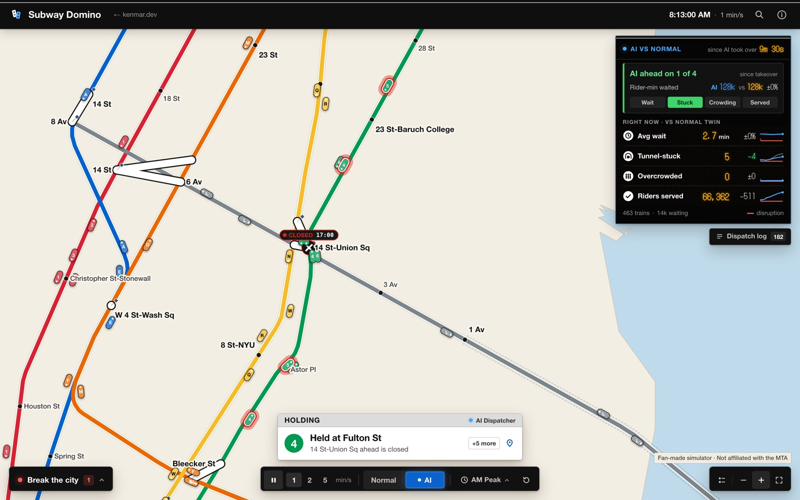
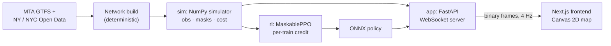
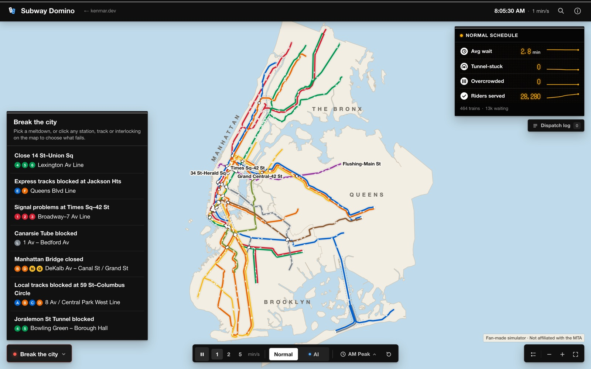
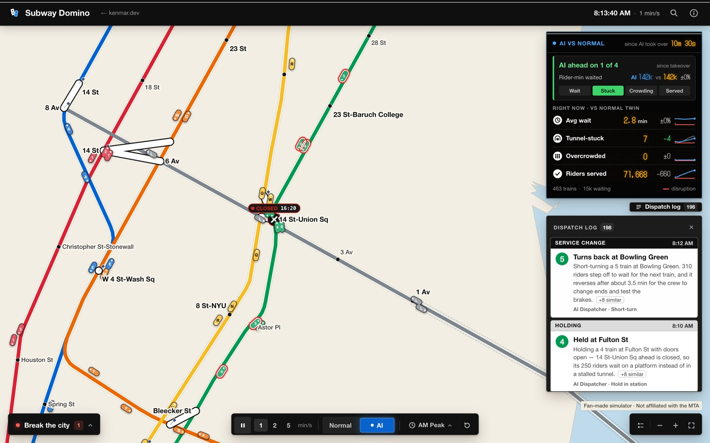
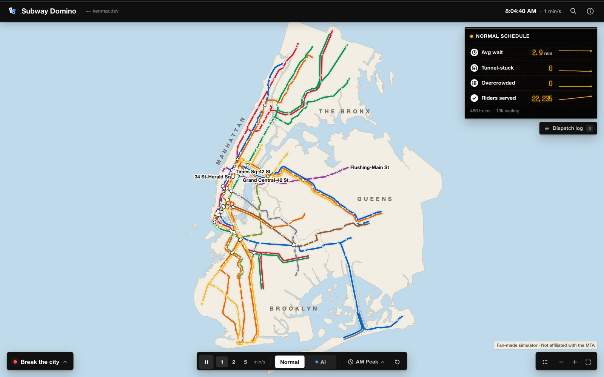
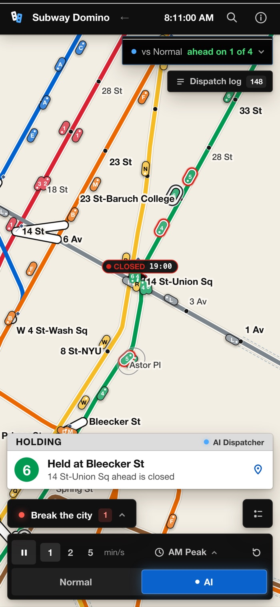
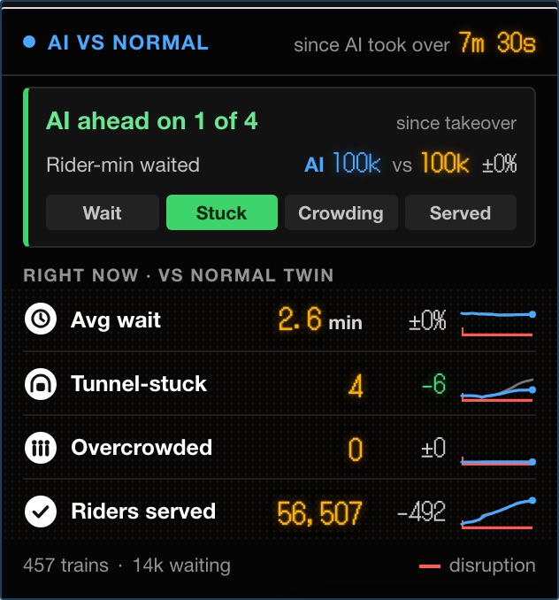

# Subway Domino

**Break the New York City subway, then see whether a trained AI dispatcher recovers it better than the timetable alone.**

### [▶ Play it live at kenmar.dev/subway](https://www.kenmar.dev/subway)




Subway Domino is a fan-made operations simulator that pits Human vs. AI on the NYC subway. You can close a station or block a tunnel (it stays broken until you restore service), then switch between **Normal Schedule** and an **AI Dispatcher**. The AI is a reinforcement-learning policy that makes Rail Control Center-style moves: it holds trains, runs them express, short-turns them and sends gap trains. The scoreboard compares the AI against a copy of the same city that keeps running the timetable.

The simulation covers Manhattan, Brooklyn, Queens and the Bronx: **28 routes, 475 stations and 424 station complexes**, with about 450 trains at AM peak. The Staten Island Railway is not modeled.

---

## What it does

- **Break the city.** Pick a preset meltdown, such as a closed 14 St-Union Sq, blocked express tracks at Jackson Hts, the Canarsie Tube or the Manhattan Bridge. You can also click any station, track or interlocking to choose what fails. There are three blockage kinds: local-track block, express-track block and full station closure. Each lasts until you clear it.
- **Compare two dispatchers.** Normal Schedule keeps every train on its timetable, so every decision is `CONTINUE_SCHEDULED`. The AI mode runs the trained policy. Either can run at AM Peak, Midday, PM Rush or Late Night, at 1, 2 or 5 sim-minutes per second.
- **Watch the scoreboard.** In AI mode, a second simulator runs the same city in lockstep under Normal Schedule. The countdown-clock scoreboard shows average wait, tunnel-stuck trains, overcrowded platforms and riders served for both. Every number comes from the live simulation and its twin.
- **Read the AI's moves.** Every AI action appears as a service-change notice, such as *"6 held at Bleecker St: 14 St-Union Sq ahead is closed"*. A dispatch log keeps the full history.

## How it works



1. **Data.** `backend/scripts/build_nyc_network.py` turns MTA GTFS static data, MTA datasets on data.ny.gov and NYC Open Data borough boundaries into deterministic network files. It infers express tracks from timetable overtakes and adds crossovers, turnbacks, interlockings and 10 yards.
2. **Simulator (`sim`).** The simulator is pure, vectorized NumPy with 10-second ticks. It models fixed-block and CBTC signaling and uses a fluid passenger model with wait-age histograms. A citywide tick takes about 0.8 ms. It is calibrated against the real system:

   | Measure | Simulator | Real subway |
   |---|---|---|
   | Average train speed, including stops | 27.6 km/h | about 27 km/h |
   | Median dwell | about 26 s | |
   | Average wait with no disruption (AM peak) | about 3.1 min | |

   Training and serving share one copy of the observation builder, action masks and cost function.
3. **RL (`rl`).** The policy is trained with MaskablePPO and exported to ONNX (opset 18). See [The AI dispatcher](#the-ai-dispatcher).
4. **Serving (`app`).** FastAPI and WebSockets run on one uvicorn worker with at most 40 sessions. Each session has its own simulator, plus the Normal twin in AI mode. All sessions share the read-only graph and one onnxruntime CPU session. The server sends binary frames of about 5 KB at 4 Hz, and a CPU governor limits load. It was load-tested with 40 Normal Schedule sessions on one CPU core, and the Docker image is about 356 MB uncompressed.
5. **Frontend (`frontend`).** Next.js 16, React 19 and TypeScript drive a Canvas 2D map at 60 fps. Trains move along the track geometry between frames, and fewer than 0.05 % of moves jump. The design borrows from NYC subway signage and the official map.

## The AI dispatcher

**Actions.** Each train is a decision point with eight possible actions. Masks rule out any action that is physically or operationally impossible, or not needed, at that moment, such as running express where there is no express track.

| # | Action | # | Action |
|---|---|---|---|
| 0 | Continue as scheduled | 4 | Skip stop |
| 1 | Hold in station | 5 | Short-turn (relay) |
| 2 | Run express | 6 | Reroute via a compatible trunk line |
| 3 | Run local | 7 | Dispatch a gap train from a yard |

**Observation.** The observation is 216 floats: 10 corridor slots × 18 features, plus 28 ego features and 8 mask bits.

**Reward: beat the timetable, not zero.** A Normal Schedule twin runs the same city in lockstep, with every decision `CONTINUE_SCHEDULED`. The reward is the difference between the AI's passenger cost and the twin's. The cost includes age-weighted waiting, tunnel-stuck trains and riders, platform crowding and small costs per action. A good action is one that beats doing nothing in the same scenario.

**Credit assignment.** Training uses per-train semi-MDP GAE. Each train is its own trajectory, discounted at 0.96 per sim-minute, so each decision's return follows that train's own later decisions instead of bootstrapping from whichever train happens to decide next. This replaced a first version that mixed all trains into one serial trajectory.

**Training.**
- **Curriculum.** Stage 1 trains on one trunk group at a time for 3M steps. Stage 2 trains citywide for 10M steps, with 1-4 disruptions, 4 demand profiles and domain randomization.
- **Rollouts.** Custom NumPy rollout workers roughly doubled throughput over SB3's `SubprocVecEnv`.
- **Time.** The shipped model's 13M-step run took about 32 min with 13 workers on a 15-core laptop (M5 Pro). A Colab notebook is at [`colab/train_subway_domino_colab.ipynb`](colab/train_subway_domino_colab.ipynb).
- **Shipping.** The shipped model is the best checkpoint (11.0M steps), exported to ONNX and served on CPU with onnxruntime. In serving, the policy picks the highest-scoring valid action.

## Results

The shipped model ran against Normal Schedule on **50 held-out evaluation scenarios** covering 4 demand profiles and 1-3 disruptions each. The full report is in [`backend/models/eval_report.md`](backend/models/eval_report.md).

| Metric (mean over 50 scenarios) | Normal | AI | Change |
|---|---|---|---|
| **Total passenger cost** | 18.26M | 14.04M | **−23.1 %** |
| Average wait (min) | 4.92 | 4.67 | −5.1 % |
| Tunnel-stuck train-minutes | 453.8 | 329.6 | −27.4 % |
| Overcrowded platform-minutes | 21.9 | 19.8 | −9.5 % |
| Riders served | 356,448 | 356,880 | +0.1 % |

- **The AI beats Normal on 86 % of scenarios.**
- **The AI removes 24 % of the extra waiting a disruption causes** (95 % CI 9-39 %). This is measured against a calm run of the same scenario without its disruptions.
- **Not every target was met.** The internal bar asked for at least 20 % of excess wait removed, a win rate of at least 70 % and at least a 30 % cut in tunnel-stuck time. The model cut tunnel-stuck time by 27.4 %, which misses the target. It was shipped anyway by explicit decision, as the best of six training configurations.

**Against a rule-based dispatcher.** An evaluation-only rule-based dispatcher was scored on the same scenarios. It is a benchmark and was never shipped.

| | AI (shipped) | Rule-based (eval only) |
|---|---|---|
| Total cost | **−23.1 %** | −19.2 % |
| Excess wait removed | **24 %** | 20 % |
| Tunnel-stuck train-minutes | −27.4 % | **−33 %** |
| Scenarios better than Normal | 86 % | **90 %** |

The AI does better than the rules on cost, waiting and crowding. The rules do better on tunnel jams and win more scenarios.

## Screenshots

| Break the city | Dispatch log |
|---|---|
|  |  |

| Citywide view, Normal Schedule | Mobile, AI mode |
|---|---|
|  |  |

<p align="center">
  
</p>

## Run it locally

**Backend.** All Python commands run from `backend/` with Python 3.11.

```bash
cd backend
python3.11 -m venv .venv
.venv/bin/pip install -r requirements-dev.txt        # use requirements-train.txt for training
.venv/bin/uvicorn app.main:app --port 8000 --reload  # http://localhost:8000/health
```

**Frontend.** In a second terminal:

```bash
cd frontend
npm ci
npm run dev   # open http://localhost:3000/subway (connects to ws://localhost:8000/ws)
```

**Tests and checks.**

```bash
# backend, from backend/ (about 240 fast tests; tests marked "slow" or "train" are excluded)
.venv/bin/python -m pytest -q -m "not slow and not train"
# frontend, from frontend/ (251 unit tests; `npm run screenshots` runs the Playwright e2e)
npm run typecheck && npm run lint && npm test && npm run build
```

**Data, training and evaluation.** Run these from `backend/`:

| Task | Command |
|---|---|
| Rebuild the network (needs internet) | `.venv/bin/python -m scripts.build_nyc_network` |
| Verify committed data against the raw cache | `.venv/bin/python -m scripts.build_nyc_network --offline --check` |
| Train | `.venv/bin/python -m rl.train --run-dir runs/local --n-envs 14 --resume auto` |
| Export to ONNX | `.venv/bin/python -m rl.export_onnx --checkpoint runs/local/best_model.zip --out models/nyc_subway_rcc_ppo.onnx` |
| Evaluate (50 seeds) | `.venv/bin/python -m rl.evaluate --policy models/nyc_subway_rcc_ppo.onnx --seeds 50 --out models/` |

If the ONNX model is missing, the server runs Normal Schedule only and reports AI mode as unavailable. It never falls back to a heuristic.

## Deploy

The browser loads the frontend from Vercel and connects straight to Railway over `wss://`. WebSockets never go through a Vercel rewrite.

**Backend on Railway**
- Root Directory: `backend`. The build uses the `Dockerfile` (see `backend/railway.json`), with health check `/health`.
- Variables: `PORT=8000`, `ALLOWED_ORIGINS=https://kenmar.dev,https://www.kenmar.dev` and `MAX_SESSIONS=40`.
- Public domain: set the target port to **8000**. The live backend is `wss://subway-domino-production.up.railway.app/ws`.

**Frontend on Vercel**
- Project root: `frontend`.
- Environment variable: `NEXT_PUBLIC_WS_URL=wss://<railway-domain>/ws`. Production builds require it.
- The app is served under `basePath: "/subway"`.

**kenmar.dev.** The portfolio repo's `vercel.json` rewrites `/subway` and `/subway/:path*` to the frontend deployment:

```json
{
  "rewrites": [
    { "source": "/subway", "destination": "https://<frontend-deployment>.vercel.app/subway" },
    { "source": "/subway/:path*", "destination": "https://<frontend-deployment>.vercel.app/subway/:path*" }
  ]
}
```

## Repo layout

```
backend/
  sim/         simulator, observations, masks, cost, ONNX runner (NumPy only)
  rl/          training, evaluation, ONNX export (the only place torch/gymnasium/sb3 are imported)
  app/         FastAPI + WebSocket server
  scripts/     deterministic network build (stdlib + NumPy)
  data/        network.json, network_geo.json, infrastructure.json (hand-curated overlay)
  models/      nyc_subway_rcc_ppo.onnx, its metadata and the evaluation report
  tests/
frontend/      Next.js 16 app (Canvas map, scoreboard, dispatch log)
colab/         Colab training notebook
docs/          ARCHITECTURE.md (engineering contract), progress notes, images
PRD.md         product spec
```

The product spec is [`PRD.md`](PRD.md). The engineering contract is [`docs/ARCHITECTURE.md`](docs/ARCHITECTURE.md), which covers the data schemas, observations, actions and reward, the WebSocket protocol, and deployment.

## Data & credits

- **MTA GTFS static schedule:** routes, stops, trips and shapes.
- **Open Data (data.ny.gov):** [MTA Subway Stations and Complexes](https://data.ny.gov/d/5f5g-n3cz) (`5f5g-n3cz`) and [MTA Subway Hourly Ridership](https://data.ny.gov/d/5wq4-mkjj) (`5wq4-mkjj`).
- **NYC Open Data:** borough boundaries for the basemap.

> **Fan-made simulator. Not affiliated with, endorsed by or connected to the Metropolitan Transportation Authority (MTA).** The app uses no MTA logos. Route colors and signage styling are used only to make the map readable. The simulation is a model, not a prediction of real service.

Built by [kenmar.dev](https://www.kenmar.dev).
